# kkt

**macOS 카카오톡을 터미널에서 읽고 보내는 개인용 CLI.** 채팅과 공지를 읽고, 메시지와 사진을 보내고, 새 메시지를 스트림으로 받아 자동화나 AI 에이전트에 연결합니다.

[](LICENSE)


<p align="center">
  
</p>
<p align="center"><sub>화면의 방 이름, ID, 대화는 모두 예시입니다.</sub></p>

```sh
kkt chats --limit 5                                   # 최근 채팅방
kkt messages --chat "모집방" --since 7d               # 최근 일주일 메시지
kkt search "점심" --since 12h                         # 본문 검색
kkt notice --chat "미션방" --json                     # 방 공지 전문
kkt send --chat-id 18000000000000001 --text "확인" --image ~/Pictures/photo.png
kkt serve --interval 1                                # 새 메시지 실시간 스트림
```

> [!NOTE]
> 카카오가 만들거나 승인한 도구가 아닙니다. **본인 Mac의 본인 계정 전용**입니다. 카카오 서버에 로그인하지 않고 서버 API나 LOCO 프로토콜도 쓰지 않습니다. 이미 로그인한 카카오톡의 로컬 데이터와 화면만 사용합니다.

## 왜 kkt인가요?

카카오 공식 API로는 대화 기록을 읽거나 자유롭게 메시지를 보낼 수 없습니다. kkt는 내 Mac에 이미 있는 카카오톡을 직접 다룹니다.

- **일하는 중에 방해하지 않습니다.** 글과 사진은 카카오톡을 앞으로 꺼내지 않고 보냅니다. 메인 창이 최소화되거나 닫혀 있어도 되고, 끝나면 그 상태로 되돌립니다. 사용자가 연 창은 닫지 않습니다.
- **읽기는 빠르고 안전합니다.** 암호화된 로컬 DB를 읽기 전용으로 엽니다. 서버에서 기록을 가져오지 않습니다.
- **보낸 뒤 확인합니다.** 전송 결과를 DB에서 다시 확인합니다. 확실하지 않으면 `sent`가 아니라 `uncertain`을 돌려줍니다.
- **자동화에 맞춰 만들었습니다.** 결과는 JSON으로 나오고, 실패 사유는 코드로 구분됩니다. Swift 라이브러리 `KktCore`로도 쓸 수 있습니다.

## 할 수 있는 일

| 하고 싶은 일 | 명령 |
|---|---|
| 채팅방 목록 보기 | `kkt chats` |
| 방의 메시지 읽기 | `kkt messages` |
| 본문 검색 | `kkt search` |
| DB를 SQL로 조회 (읽기 전용) | `kkt query` |
| 방 공지 전문 읽기 | `kkt notice` |
| 글·사진 보내기 | `kkt send` |
| 새 메시지 실시간 받기 | `kkt serve` |
| 오픈채팅 참여 | `kkt join` |
| 프로필 카드로 친구 추가·1:1 열기 | `kkt contact` |
| 환경 점검 | `kkt doctor` |

## 시작하기

### 1. 준비물

- macOS 14 이상, Swift 6
- macOS 카카오톡 설치와 로그인 (**26.9에서 검증**)
- Homebrew

### 2. 설치

```sh
git clone https://github.com/posth2071/kkt.git
cd kkt
brew install sqlcipher
scripts/install.sh
```

`~/.local/bin/kkt`에 설치됩니다. `~/.local/bin`을 `PATH`에 넣어 주세요.

### 3. 권한 주기

**시스템 설정 → 개인정보 보호 및 보안**에서 kkt를 실행하는 앱(보통 터미널)에 권한을 줍니다.

| 권한 | 왜 필요한가요 |
|---|---|
| 전체 디스크 접근 | 카카오톡 로컬 DB 읽기 |
| 손쉬운 사용 | 채팅 창 열기, 입력, 전송 |
| 화면 기록 | `contact`의 프로필 카드 인식 (이 명령을 쓸 때만) |

> [!TIP]
> 권한은 **kkt를 실행한 프로그램** 기준입니다. 터미널이면 터미널 앱에, `node` 데몬에서 실행하면 `node`에 줘야 합니다.

### 4. 연결 확인

```sh
kkt auth      # 내 계정을 찾고 DB를 열 수 있는지 확인
kkt doctor    # 권한과 환경 점검
```

`doctor`에 `fail`이 없으면 준비가 끝났습니다. 첫 `auth`는 시간이 걸릴 수 있습니다. DB 키는 실행할 때마다 계산하고 어디에도 저장하지 않습니다.

### 5. 써 보기

먼저 읽기부터 해 보세요. 방을 열지 않아 안전합니다.

```sh
kkt chats --limit 5
```

보내기는 `--dry-run`으로 대상 방이 맞는지 확인한 뒤 진행하는 것을 권합니다. `--dry-run`도 방을 열기 때문에 안 읽은 표시가 사라질 수 있습니다.

```sh
kkt send --chat-id 18000000000000001 --text "안녕하세요" --dry-run
kkt send --chat-id 18000000000000001 --text "안녕하세요"
```

```json
{"chatId":18000000000000001,"logId":3966430300338980864,"result":"sent"}
```

## 자동화와 AI 에이전트

명령 결과는 JSON으로 받을 수 있어서 스크립트나 코딩 에이전트에서 바로 쓸 수 있습니다.

```sh
kkt messages --chat "모집방" --since 1d --json
kkt query "SELECT COUNT(*) FROM NTChatMessage" --json
```

`serve`는 새 메시지를 한 줄에 JSON 하나로 계속 내보냅니다. 파이프로 봇이나 감시 프로그램에 연결하세요.

```sh
kkt serve --interval 1 | your-agent
```

> [!IMPORTANT]
> 채팅방 ID와 메시지 ID는 2^53보다 클 수 있습니다. JavaScript 일반 `JSON.parse`로 읽으면 값이 깨지니 정밀도를 보존하는 파서를 쓰세요.

터미널에서 실행하면 오래 걸리는 작업의 진행 단계가 표준오류에 잠깐 표시됩니다. 파이프나 파일로 받을 때는 나오지 않고, 표준출력의 결과에도 섞이지 않습니다. PTY로 실행하며 화면 출력을 읽는 도구는 `KKT_NO_PROGRESS=1`로 끄세요.

출력 필드와 실패 코드는 [레퍼런스](docs/reference.md#기계-출력-계약)에 있고, Swift에서 쓰려면 [라이브러리 가이드](docs/library.md)를 보세요.

## 동작 원리

```text
읽기   kkt → 로컬 DB (SQLCipher, 읽기 전용)
쓰기   kkt → 손쉬운 사용(AX) + 카카오톡 프로세스로 보내는 키 입력 → 카카오톡 앱
확인   kkt → 로컬 DB에서 전송 결과 확인
```

kkt 소스에는 네트워크 전송 코드가 없습니다. 메시지는 사용자가 쓰는 카카오톡 앱이 보냅니다.

사진 전송은 비공개 macOS API(SkyLight)로 카카오톡을 앞으로 꺼내지 않고 붙여 넣습니다. 이 방식이 실패하면 카카오톡을 잠깐 앞으로 가져오는 방식으로 자동 전환하고, 결과의 `imageRoute`가 `foreground`로 나옵니다.

## 문제 해결

먼저 `kkt doctor`를 실행해 보세요. 자주 만나는 결과는 다음과 같습니다.

| 결과 | 뜻 | 해결 |
|---|---|---|
| `chat_window_open` | 카카오톡 채팅 창이 열려 있음 | 창을 닫고 다시 실행 |
| `kakaotalk_in_use` | 카카오톡이 맨 앞에 있음 | 다른 앱으로 옮긴 뒤 다시 실행 |
| `kakaotalk_not_running` | 카카오톡이 꺼져 있음 | 카카오톡 실행 후 로그인 |
| `ambiguous_name` | 같은 이름의 방이 여러 개 | `--chat-id`로 지정 |
| `input_locked` | 방의 입력이 잠겨 있음 | 카카오톡에서 방 상태 확인 |
| `automation_failed` | 화면 조작을 확인하지 못함 | `kkt doctor`로 점검 |
| `uncertain` | 보냈는지 확정하지 못함 | **바로 다시 보내지 말고** 방에서 확인 |

전체 목록은 [reason 코드](docs/reference.md#reason-코드)에 있습니다.

## 알아 둘 제한

- **나와의 채팅**은 채팅 목록에 보일 때만 열 수 있습니다.
- **방을 열면** 안 읽은 표시가 사라질 수 있습니다. 공지 행이 DB에 없는 방은 공지를 읽을 때도 방을 엽니다.
- **공지:** DB 본문은 공지 수정 전 내용일 수 있습니다(`source: database`). 배너 아이콘이 다른 일부 방은 공지가 있어도 `not_found`가 나올 수 있습니다.
- **일부 동작은 카카오톡이 잠깐 앞으로 옵니다.** 공지 배너 클릭, 프로필 카드 클릭, 오픈채팅 링크 열기가 그렇습니다. 사진 전송도 드물게 이 방식으로 전환됩니다(`imageRoute: foreground`). 끝나면 쓰던 앱으로 돌아갑니다.
- **`contact`** 는 화면의 프로필 카드를 인식하므로 화면 크기와 스크롤 위치에 영향을 받습니다.
- **카카오톡 업데이트**로 DB나 화면 구조가 바뀌면 동작이 달라질 수 있습니다. [업데이트 대응 절차](docs/maintenance.md)를 따르세요.
- **로컬에 없는 메시지**는 읽을 수 없습니다. 서버에서 과거 기록을 가져오지 않습니다.

## 자주 묻는 질문

**공식 도구인가요?**
아닙니다. 카카오와 관련 없는 비공식 개인 도구입니다.

**계정이 제재될 수 있나요?**
kkt는 서버 프로토콜을 직접 쓰지 않고 앱을 사람처럼 조작하지만, 안전을 보장하지는 않습니다. 약관 준수와 사용 결과는 사용자 책임입니다.

**다른 사람 계정이나 다른 Mac의 데이터도 읽나요?**
아닙니다. 그 Mac에 로그인한 본인 계정의 로컬 데이터만 읽습니다.

**비밀번호나 DB 키가 저장되나요?**
카카오 비밀번호는 쓰지 않습니다. DB 키는 실행할 때마다 계산하고 설정, 로그, 출력에 남기지 않습니다.

**Windows나 Linux에서 되나요?**
아니요. macOS 카카오톡 전용입니다.

## 문서

- [레퍼런스](docs/reference.md) — 전체 명령, 설정, 출력 형식, 실패 코드
- [KktCore 라이브러리 가이드](docs/library.md) — Swift에서 사용하기
- [카카오톡 업데이트 대응](docs/maintenance.md)
- [카카오톡 26.9 구조 분석](docs/re/2026-11-03-kakaotalk-26.9.md) · [실측 기록](docs/verification/2026-11-03.md)
- [설계 기록](docs/dev/specs/2026-11-03-kkt-cli-design.md) · [구현 계획](docs/dev/plans/2026-11-03-kkt-v1.md)
- [변경 기록](CHANGELOG.md)

## 감사의 말

DB 열기와 키 계산 등 일부 코드는 [kakaocli](https://github.com/silver-flight-group/kakaocli)(MIT)에서 이식했습니다. 자세한 내용은 [서드파티 고지](THIRD_PARTY_NOTICES.md)를 보세요.

## 라이선스와 면책

[MIT](LICENSE) 라이선스입니다.

카카오가 제공, 승인, 지원하는 제품이 아닙니다. 본인 Mac과 본인 계정에서만 사용하고, 카카오톡 이용약관과 개인정보 보호 의무를 지켜 주세요. UI 자동화는 방을 열어 읽음 상태를 바꾸거나 메시지를 전송할 수 있습니다.

개발자는 동작과 버전 호환성을 보증하지 않습니다. 오발송, 중복 전송, 읽음 처리, 계정 이용 제한, 데이터 손실 등 사용 결과에 책임지지 않습니다. 사용 여부와 자동화 결과 확인은 사용자의 책임입니다.
